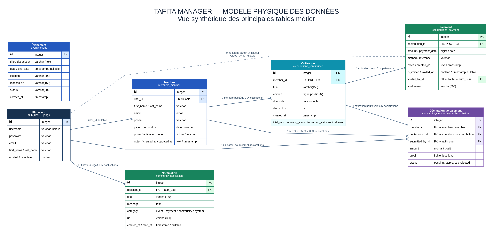

# TaFiTa Manager

Application web de gestion associative développée avec Django dans le cadre d'un projet d'étude. Elle centralise la gestion des membres, des événements, des cotisations, des paiements et des échanges communautaires.

## Liens du projet

- Application hébergée : https://tafita-manager-rajo.onrender.com
- Code source : https://github.com/rajohajaina00-web/tafita-manager
- Hébergement et déploiement : Render, à partir du fichier `render.yaml`

## Présentation

TaFiTa Manager propose un espace d'administration pour les responsables de l'association et un espace communautaire pour les membres. Les accès aux fonctionnalités sont contrôlés selon l'utilisateur connecté et ses autorisations.

## Fonctionnalités principales

- Authentification et gestion des accès pour l'administration et les membres.
- Création, consultation, modification et suivi des membres.
- Gestion des événements avec dates, lieux, responsables et états.
- Gestion des cotisations et calcul du montant payé et du solde restant.
- Enregistrement des paiements et conservation de leur historique en cas d'annulation, avec motif et auteur de l'annulation.
- Déclaration de paiements par les membres, avec justificatif, puis validation ou rejet par l'administration.
- Notifications internes liées aux événements, aux paiements et à la vie communautaire.
- Espace communautaire avec publications, discussions et profil membre.
- Tableau de bord de suivi et assistant local fournissant des informations à partir des données de l'association.

## Modèle physique des données

Le diagramme ci-dessous présente une vue synthétique des principales tables métier et de leurs relations. Les tables techniques de Django et certaines tables secondaires de l'espace communautaire ne sont pas détaillées dans ce schéma. Pour les champs, contraintes et relations exhaustifs, les modèles Django et les migrations du dépôt font référence.



Le fichier source Graphviz du diagramme est disponible dans [`docs/architecture/mpd-tafita-manager.dot`](docs/architecture/mpd-tafita-manager.dot), ainsi qu'une version SVG pour consultation et modification.

## Technologies

- Python 3.13
- Django 6.1
- HTML, CSS et JavaScript
- SQLite pour le développement local
- PostgreSQL pour la version hébergée
- Gunicorn pour le serveur d'application
- WhiteNoise pour les fichiers statiques
- Render pour l'hébergement

## Exécuter le projet en local

Depuis la racine du dépôt cloné :

```bash
python3 -m venv .venv
source .venv/bin/activate
python -m pip install -r requirements.txt
python manage.py migrate
python manage.py createsuperuser
python manage.py runserver
```

Ouvrir ensuite http://127.0.0.1:8000/ dans un navigateur. Le développement local utilise la configuration `config.settings` et SQLite, sauf configuration locale particulière.

## Tests et vérifications

Exécuter les tests avec :

```bash
python manage.py check
python manage.py makemigrations --check --dry-run
python manage.py test
```

## Déploiement sur Render

Le dépôt contient un fichier `render.yaml` pour définir les ressources Render et `build.sh` pour installer les dépendances, collecter les fichiers statiques et appliquer les migrations.

Pour créer ou mettre à jour l'environnement, connecter le dépôt GitHub dans Render et utiliser le déploiement Blueprint. Les variables d'environnement et secrets doivent être configurés dans Render et ne doivent pas être ajoutés au dépôt Git.

Les fichiers téléversés par les utilisateurs et les bases de données locales ne sont pas destinés à être publiés dans Git. Pour conserver les fichiers médias en production, prévoir un stockage persistant ou un service de stockage dédié adapté au besoin.

## Structure du dépôt

- `accounts/` : authentification et vues d'administration.
- `members/` : modèles et gestion des membres.
- `events/` : événements associatifs.
- `contributions/` : cotisations et paiements.
- `community/` : espace membre, déclarations de paiement et notifications.
- `dashboard/` : tableaux de bord.
- `ai_assistant/` : assistant local lié aux données de l'association.
- `config/` : configuration Django, URL et paramètres de déploiement.
- `templates/` : templates HTML.
- `static/` : fichiers CSS, JavaScript et ressources statiques.
- `docs/architecture/` : diagrammes d'architecture et MPD.

## Contexte du projet

Ce projet est réalisé à des fins d'étude et de démonstration. Les données de démonstration doivent être privilégiées lors de l'évaluation. Aucun compte ni mot de passe n'est publié dans ce dépôt.
